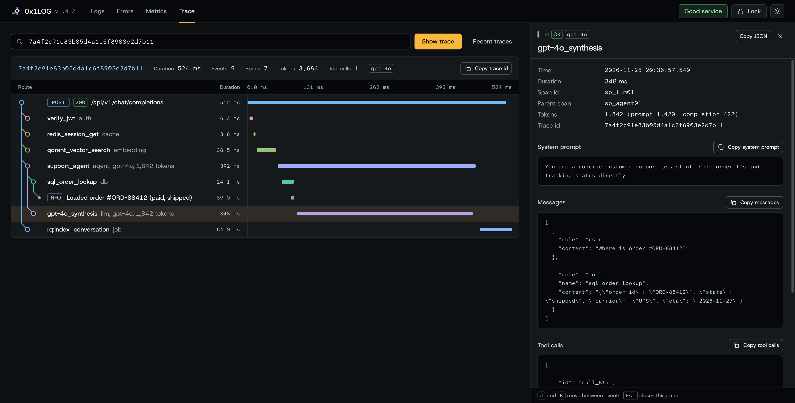
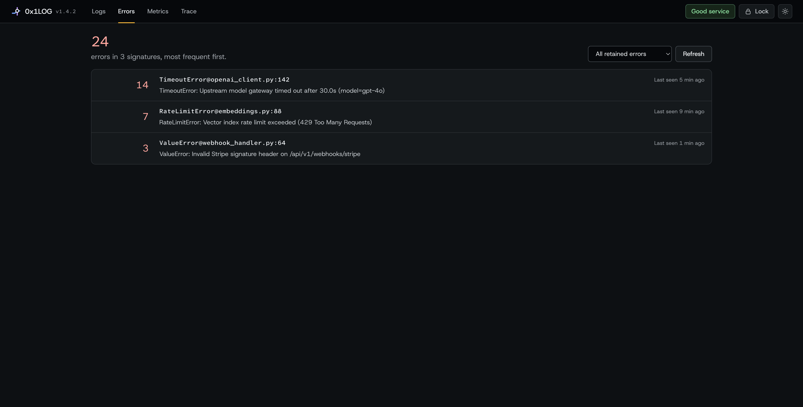
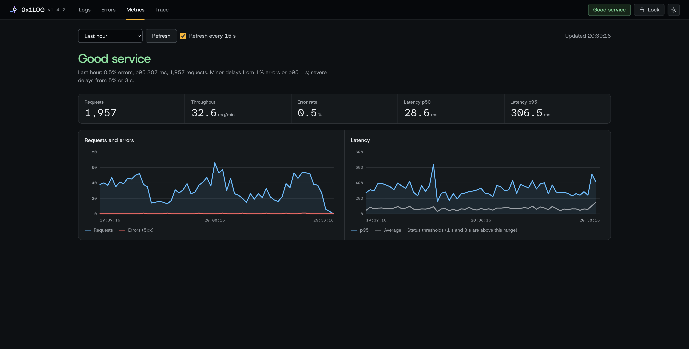

<p align="center">
  
</p>
<h1 align="center">0x1LOG</h1>
<p align="center">
  <em>Embedded observability for FastAPI. One install, one SQLite file, zero external infrastructure.</em>
</p>
<p align="center">
  <a href="https://pypi.org/project/0x1-log/"></a>
  <a href="https://pypi.org/project/0x1-log/"></a>
  <a href="https://github.com/raihan0x1/0x1-log/actions/workflows/ci.yml"></a>
  <a href="https://sonarcloud.io/summary/new_code?id=nahiarhd_nahiarhdlog"></a>
  <a href="LICENSE"></a>
</p>
<p align="center">
  <picture>
    <source media="(prefers-color-scheme: dark)" srcset="https://raw.githubusercontent.com/raihan0x1/0x1-log/main/docs/hero-dark.png">
    <source media="(prefers-color-scheme: light)" srcset="https://raw.githubusercontent.com/raihan0x1/0x1-log/main/docs/hero-light.png">
    
  </picture>
</p>
<p align="center">
  <strong>~0.04 ms request overhead &middot; 1 SQLite file (or Postgres / Redis) &middot; 0 external services &middot; 4 views in one console</strong><br>
  <sub>Searchable logs, grouped errors, live metrics, and AI/job tracing mounted right inside your FastAPI app at <code>/0x1log/</code> behind your own token.</sub>
</p>

---

## Why 0x1LOG?

Most FastAPI apps don't need an ELK cluster, Jaeger, or a SaaS billing per gigabyte just to answer *"what broke, on which request, and why?"*.

- **Zero infrastructure by default.** `pip install` and one `observe(app)` call store history in `.0x1log/0x1log.db` (SQLite WAL + FTS5) and mount a self-contained console with bundled fonts — works offline and behind strict CSPs.
- **Negligible request overhead.** Middleware enqueues a small dict (~0.04 ms p95) and a background thread batches writes to SQLite, Postgres, Redis, or an in-memory ring buffer. Bounded queues drop with a visible counter instead of ever blocking a request.
- **Scales cleanly when you grow.** Start with SQLite on a single node; switch `db_path` to `postgresql://...` for shared multi-replica history or `mode="lite"` (`memory://` / `redis://...`) for zero-DB ephemeral logs.

## Inside the console

### Logs & Smart Repeats

<p align="center">
  
</p>

Full-text FTS5 search with prefix matching, an interactive volume histogram you can brush to zoom into a time window, and cursor-backed infinite scroll. Repetitive spans, requests, and consecutive logs from the same call site (like worker queue polls `Cleaning registries for queue: * ×48`) fold automatically into a single **Repeat** row you can expand inline, while the side inspector gives you redacted headers, JSON payloads, **Copy JSON**, and **Copy as cURL**.

### AI Agent & Background Job Tracing

<p align="center">
  
</p>

Every incoming request honours W3C `traceparent` headers and renders as a branching route waterfall across auth, cache, database, vector embeddings, tool calls, LLM generations (tracking model, prompt/completion tokens, messages, and completions), and background jobs queued via **RQ** or **Celery** on the exact same `trace_id`.

### Error Grouping

<p align="center">
  
</p>

Uncaught exceptions (`sys.excepthook`, `threading.excepthook`, ASGI 500s) and `logger.exception()` calls are grouped by `ExcType@file.py:line` and ranked by frequency. Tracebacks preserve both entry and innermost frames up to 64 KB; clicking any signature jumps straight to matching events and their full trace.

### Live Metrics

<p align="center">
  
</p>

Service health verdict (`Good service`, `Minor delays`, `Severe delays`), request count, throughput, 5xx error rate, and p50/p95 latency computed directly from stored request events — numbers and charts can never disagree with the logs.

---

## Quick Start

Four steps for any FastAPI app (Python ≥ 3.10):

### 1. Install

```bash
uv add "0x1-log>=1.4" python-dotenv
# or: pip install "0x1-log>=1.4" python-dotenv
```

Optional extras: `0x1-log[postgres]`, `0x1-log[redis]`, `0x1-log[otel]`.

### 2. Set a dashboard token in `.env`

```bash
# .env — do not commit this file
OX1LOG_TOKEN=change-me-to-a-long-random-secret
```

0x1LOG **never reads `.env` itself** — your app loads and passes config explicitly so the same package behaves identically across environments.

### 3. Wire `observe(app)`

```python
import os
from dotenv import load_dotenv
from fastapi import FastAPI
from ox1log import observe

load_dotenv()

app = FastAPI()
observe(app, dashboard_token=os.environ.get("OX1LOG_TOKEN"))
```

No `dashboard_token`? Event collection still runs; `/0x1log/` serves a setup notice instead of exposing data.

### 4. Run and open the console

```bash
uv run uvicorn main:app --reload
```

Open `http://127.0.0.1:8000/0x1log/` and enter the token.

---

## Storage & Deployment Modes

| Mode / Backend | Config | Best for |
| --- | --- | --- |
| **SQLite WAL + FTS5** *(default)* | `observe(app, dashboard_token=...)` | Single-host apps & API + worker sharing one local disk volume (`.0x1log/0x1log.db`) |
| **Shared Postgres** | `pip install "0x1-log[postgres]"` + `db_path="postgresql://..."` | Multi-replica deployments where every pod reads/writes the same history (`ox1log_events`) |
| **Lite (`memory://`)** | `observe(app, mode="lite", dashboard_token=...)` | Ephemeral bounded ring buffer (5,000 events/source), skips request middleware & DB writes |
| **Lite (`redis://`)** | `pip install "0x1-log[redis]"` + `mode="lite", db_path="redis://..."` | Multi-pod API + worker live logs merged in a bounded Redis ring buffer with TTL |

### Workers, Loguru, RQ & Celery

Attach non-FastAPI processes (`attach()`) to the same SQLite, Postgres, or Redis target, and keep background jobs on the same `trace_id` as the request that queued them:

```python
from ox1log import attach

# Worker process (call after fork in prefork pools)
collector = attach(db_path=".0x1log/0x1log.db", source="worker")

# Loguru sink (optional)
# from ox1log.handler import LogHandler
# logger.add(LogHandler(collector), format="{message}")
```

```python
# RQ (1.16+): mix JobTraceMixin into your Worker and attach trace_meta() when enqueueing
from ox1log.integrations.rq import JobTraceMixin, trace_meta

class Worker(JobTraceMixin, rq.Worker): ...
queue.enqueue(process_batch, batch_id, meta=trace_meta(name="reports.monthly"))

# Celery: call once in both API sender and worker process
from ox1log.integrations.celery import trace_tasks
trace_tasks()

# Any custom runner (arq, cron, scripts)
from ox1log.integrations import job_span
with job_span("nightly_report", traceparent):
    run_report()
```

---

## Reference

<details>
<summary><strong>Configuration</strong> — all <code>observe()</code> arguments</summary>

| Argument | Default | Meaning |
| --- | --- | --- |
| `mode` | `"full"` | `"full"` enables request middleware + persistent storage; `"lite"` skips request middleware and defaults to bounded `memory://` |
| `db_path` | `".0x1log/0x1log.db"` (`"memory://"` in `lite`) | `"memory://"`, `"redis://..."`, SQLite path, or `"postgresql://..."` |
| `key_prefix` | `"ox1log"` | Redis key prefix (isolates services sharing one Redis instance) |
| `max_events` | `5000` | Ring-buffer cap per source for `memory://` and `redis://` |
| `dashboard_token` | `None` (setup page) | Secret token locking the console; unset keeps data disabled behind a setup notice |
| `dashboard_prefix` | `"/0x1log"` | Mount path for the embedded console and JSON API |
| `retention_days` | `7` | Event retention window before automatic purging |
| `sample_rate` | `1.0` | `1.0` keeps every request; `5xx` responses are always retained |
| `level` | `logging.INFO` | Minimum stdlib logging level captured |
| `skip_paths` | `[]` | Extra path prefixes ignored by request middleware (`dashboard_prefix` is always excluded) |
| `capture_body` | `True` (`False` in `lite`) | Capture request/response headers & payloads with sensitive field redaction |
| `max_body_size` | `65536` | Max captured payload bytes before head/tail truncation |

</details>

<details>
<summary><strong>AI Agent &amp; Span Tracing</strong> — instrumenting LLMs, embeddings, and tools</summary>

```python
from fastapi import FastAPI
from ox1log import ai_span, observe, span

app = FastAPI()
observe(app, dashboard_token="secret", capture_body=True)

@app.post("/api/v1/chat/completions")
def chat_agent(req: dict):
    with span("qdrant_vector_search", span_type="embedding", input_data={"q": req["prompt"]}) as s:
        s.set_output({"matches": 5})

    with ai_span("support_agent", model="gpt-4o", messages=req.get("messages")) as ai:
        with span("sql_order_lookup", span_type="tool", input_data={"order_id": "ORD-88412"}) as tool:
            tool.set_output({"state": "shipped"})
        ai.set_completion("Order #ORD-88412 is in transit via UPS.")
        ai.set_tokens(prompt_tokens=1420, completion_tokens=422)
        ai.set_tool_calls([{"name": "sql_order_lookup", "args": {"order_id": "ORD-88412"}}])

    return {"response": "Order #ORD-88412 is in transit via UPS."}
```

</details>

<details>
<summary><strong>Alerts &amp; OpenTelemetry</strong> — threshold rules, sinks, and trace export</summary>

```python
from ox1log import observe
from ox1log.alerter import Rule, SmtpSink, TelegramSink, WebhookSink

observe(
    app,
    rules=[Rule("api-errors", count=10, window_seconds=600, cooldown_seconds=1800)],
    sinks=[
        WebhookSink("https://hooks.example/deploy"),
        TelegramSink(bot_token="123:ABC", chat_id="-100..."),
        SmtpSink("smtp.example.com", ["ops@example.com"], username="bot", password="..."),
    ],
    dashboard_token="secret",
)
```

Export any stored trace to OpenTelemetry (`pip install "0x1-log[otel]"`):

```python
from ox1log.otel import export_trace
from ox1log.query import get_trace

export_trace(get_trace(collector.storage, trace_id))
```

</details>

<details>
<summary><strong>Custom storage backends</strong> — plug in your own storage</summary>

Pass any storage object matching `SQLiteStorage` in `ox1log/storage.py` to `Collector(storage=...)` or `observe(app, storage=...)`:

| Member | Role |
| --- | --- |
| `insert_many(events) -> int` | Persist a batch from the background writer thread |
| `search(...) -> list[dict]` | Newest-first events with text, level, type, trace, signature, and time filters |
| `count(...) -> int` | Match count for the same filters |
| `top_signatures(since, limit) -> list` | `[{signature, count, last_ts, last_message}]` for the Errors view |
| `fetch_requests(since, until) -> list` | `[{ts, status, duration_ms}]` rows for Metrics |
| `get(event_id) -> dict \| None` | Fetch a single event by id |
| `purge() -> int` | Delete events older than retention |
| `close() -> None` | Release connections/handles |
| `fts_available -> bool` | Whether full-text search is active |

Optionally implement `reopen() -> None` so repeated app lifespans (such as multiple `TestClient` runs) can restart cleanly.

</details>

<details>
<summary><strong>FAQ</strong> — security, multi-replica behaviour, and overhead</summary>

- **Does 0x1LOG read my `.env`?** No. Pass values via `observe(app, dashboard_token=..., db_path=...)` from your own settings loader.
- **How is the dashboard secured?** All API endpoints require a valid token (`Authorization: Bearer ...` or HTTP-only login cookie scoped to `dashboard_prefix`, marked `Secure` over HTTPS). Sensitive headers (`Authorization`, `Cookie`), query params, and form keys are redacted (`[REDACTED]`) before storage.
- **Can two separate hosts share one SQLite file?** No — SQLite WAL requires processes to share local disk on the same host. Use `db_path="postgresql://..."` or `mode="lite"` with `db_path="redis://..."` for multi-host deployments.
- **What is the runtime overhead?** Requests enqueue a dict in memory (~0.04 ms p95) and flush in batches on a background thread. Run `uv run python scripts/probe_perf.py --n 10000` to benchmark locally.
- **Framework support?** FastAPI first; the core (`collector`, `storage`, `query`, `alerter`, `metrics`, `attach`) never imports FastAPI/Starlette (enforced by `tests/test_adapter_boundary.py`).
- **Demo app?** Run `uv run python examples/basic_app.py serve` in one terminal and `uv run python examples/basic_app.py traffic --n 300` in another, then open `http://127.0.0.1:8000/0x1log/` with token `demo-token`.

</details>

<details>
<summary><strong>Development &amp; Releasing</strong></summary>

```bash
# Run all local checks (shell scripts, dashboard JS syntax, full pytest suite)
./scripts/check.sh

# Bump version, update uv.lock & CHANGELOG.md, verify, commit, and push to main (CI publishes to PyPI)
./scripts/release.sh            # interactive (patch / minor / major / custom)
./scripts/release.sh patch      # or: --dry-run
```

</details>

---

## License

[MIT](LICENSE) — see [CHANGELOG.md](CHANGELOG.md) for release notes.

By [Raihan Hidayatullah Djunaedi](https://github.com/raihan0x1) &middot; [PyPI](https://pypi.org/project/0x1-log/)

<a href="https://www.star-history.com/#raihan0x1/0x1-log&Date">
  <picture>
    <source media="(prefers-color-scheme: dark)" srcset="https://api.star-history.com/svg?repos=raihan0x1/0x1-log&type=Date&theme=dark" />
    <source media="(prefers-color-scheme: light)" srcset="https://api.star-history.com/svg?repos=raihan0x1/0x1-log&type=Date" />
    
  </picture>
</a>
