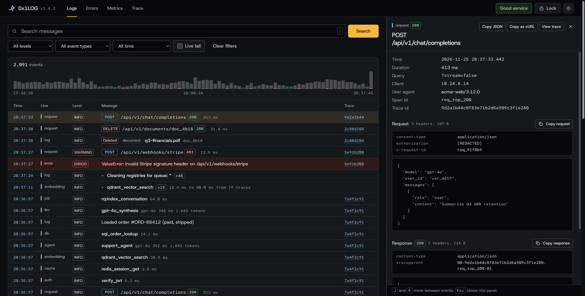

<a name="nahiarhdlog"></a>

# 0x1LOG

[](https://github.com/raihan0x1/0x1-log/actions)
[](https://pypi.org/project/0x1-log/)
[](https://pypi.org/project/0x1-log/)
[](https://opensource.org/licenses/MIT)

Embedded observability for FastAPI — searchable logs, error tracking, alerts, metrics, tracing, and a token-locked dashboard. Zero infrastructure: everything lives in one SQLite file.



<a name="why-nahiarhdlog"></a>

## Why 0x1LOG?

- **No infrastructure.** No ELK, no agents, no SaaS — `pip install` and you have history, search, and a UI.
- **Embedded dashboard.** Your logs live at `/0x1log` inside your own app, behind your own token.
- **Negligible overhead.** Requests enqueue a small dict (p95 ~0.04 ms); SQLite writes happen in batches on a background thread. The queue is bounded — when full, events drop with a visible counter instead of ever blocking a request.
- **Framework-agnostic core.** FastAPI first; the core imports no web framework, so Flask/Django adapters can follow without changing it.

## New project setup

Four steps. Nothing else is required for a FastAPI app.

### 1. Install

```bash
uv add "0x1-log>=1.3" python-dotenv
# or: pip install "0x1-log>=1.3" python-dotenv
# for multi-pod API + worker ephemeral logs in Redis:
# pip install "0x1-log[redis]>=1.3"
```

Python ≥ 3.10. In default `mode="full"`, logs land in `.0x1log/0x1log.db`. In `mode="lite"`, logs stay in a bounded in-memory ring buffer (`memory://`) or Redis (`redis://...`) with zero database writes.

### 2. Put a token in `.env`

```bash
# .env  — do not commit this file
OX1LOG_TOKEN=change-me-to-a-long-random-string
```

0x1LOG **does not read `.env` for you.** Your app loads it and passes the value in. That way the same package works in every project.

### 3. One call in your app

```python
import os
from dotenv import load_dotenv
from fastapi import FastAPI
from ox1log import observe

load_dotenv()

app = FastAPI()
observe(app, dashboard_token=os.environ.get("OX1LOG_TOKEN"))
```

That captures every request, every stdlib log, and every uncaught exception.

### 4. Run and open the dashboard

```bash
uv run uvicorn main:app --reload
```

Open `http://127.0.0.1:8000/0x1log/` and type the token from `.env`.

No token set? Collection still runs; the URL shows a setup page instead of data.

### Lite mode (ephemeral logs, zero DB)

Only want live API + worker logs without request-body middleware or Postgres/SQLite bloat? Pass `mode="lite"`:

```python
# Single-process zero-infra default (bounded memory:// ring buffer, 5000 events/source)
observe(app, mode="lite", dashboard_token=os.environ.get("OX1LOG_TOKEN"))

# Multi-pod API + worker merged in Redis (pip install "0x1-log[redis]>=1.3")
observe(
    app,
    mode="lite",
    db_path=os.environ.get("REDIS_URL", "memory://"),
    key_prefix="ox1log:my-service",
    dashboard_token=os.environ.get("OX1LOG_TOKEN"),
)
```

In your worker process, call `attach(db_path=os.environ["REDIS_URL"], source="worker", key_prefix="ox1log:my-service")`. Filter by source or tail incrementally via `GET /0x1log/api/logs?source=worker&after_id=42` and inspect active sources via `GET /0x1log/api/health`.

### Optional: a worker, cron job, or script

A second process has no FastAPI app, so `observe()` does not apply. In **that** process, point at the same database:

```python
from ox1log import attach
attach()  # same default path: .0x1log/0x1log.db
```

Call it *in* the process that logs (after fork, if you use a prefork pool). Using [loguru](https://github.com/Delgan/loguru)? It does not go through stdlib — add the handler as a sink:

```python
from ox1log import attach
from ox1log.handler import LogHandler

collector = attach()
logger.add(LogHandler(collector), format="{message}")
```

### Upgrade an existing app

Replace the old `nahiarhdlog` dependency with `0x1-log>=1.3` and update imports from `nahiarhdLOG` to `ox1log`, including submodules. Legacy `/nahiarhdlog` and `.nahiarhdlog/` fallbacks were removed in `1.3.0`; new cookies use `ox1log_token` and Postgres tables use `ox1log_events`.

## Features

| Area | What you get |
| ---- | ------------ |
| Logs | Auto-captured stdlib records + requests; full-text search (FTS5) with prefix matching, level/type/time/trace filters, an event-volume histogram you can click to narrow the range, pagination |
| Errors | Grouped by `ExcType@file.py:line`, full tracebacks, top-errors ranking |
| Alerts | Threshold rules (N events in M seconds) + cooldown; webhook, Telegram, and SMTP sinks |
| Metrics | RPS, error rate, latency p50/p95, time-bucketed series — computed from the same request events |
| Tracing | W3C `traceparent` in and out; one `trace_id` per request; traces drawn as a route (spans nest under the request, logs under the span they ran in) with a timeline; AI agent span tracing (`ai_span`, `span`); request & response payload inspection |
| Dashboard | Embedded at `/0x1log`, token-locked, follows the OS theme (with a toggle), mobile-friendly, live tail, service status in the header, side inspector with `J`/`K` navigation and copy-as-cURL, self-contained (fonts ship with the package) |

<details>
<summary><strong>Configuration</strong> — all arguments and <code>.env</code> wiring</summary>

`observe()` takes explicit arguments and never reads your environment or `.env` file itself — each app owns its config, so the same package works unchanged across projects:

| Argument | Default | Meaning |
|---|---|---|
| `mode` | `"full"` | `"full"` enables request middleware + persistent storage; `"lite"` skips request middleware and defaults to bounded `memory://` |
| `db_path` | `".0x1log/0x1log.db"` (`"memory://"` in `lite`) | `"memory://"`, `"redis://..."` (`0x1-log[redis]`), SQLite path, or `"postgresql://..."` (`0x1-log[postgres]`) |
| `key_prefix` | `"ox1log"` | Redis key prefix (isolates services sharing one Redis instance) |
| `max_events` | `5000` | Ring-buffer cap per source for `memory://` and `redis://` |
| `dashboard_token` | `None` (setup page) | Token for the dashboard; unset = setup page, data stays off |
| `dashboard_prefix` | `"/0x1log"` | Where the dashboard lives |
| `retention_days` | `7` | How long events are kept |
| `sample_rate` | `1.0` | 1.0 = every request; 500s are always kept |
| `level` | `logging.INFO` | Minimum stdlib level captured |
| `skip_paths` | `[]` | Extra paths the middleware ignores (dashboard prefix is always excluded) |
| `capture_body` | `True` | Automatically capture request & response headers and payloads (with secret redaction) |
| `max_body_size` | `65536` | Maximum payload bytes captured before safe truncation |

</details>

<details>
<summary><strong>AI Agent &amp; Span Tracing</strong> — instrumenting LLMs, embeddings, and tools</summary>

Trace multi-step AI agent workflows with child spans, token metrics, model parameters, and tool calls automatically tied to the active request's `trace_id`:

```python
from fastapi import FastAPI
import ox1log
from ox1log import ai_span, span

app = FastAPI()
ox1log.observe(app, dashboard_token="secret", capture_body=True)

@app.post("/api/proxy/v1/responses")
def chat_agent(req: dict):
    # Step 1: Knowledge retrieval / vector embedding
    with span("vector_search", span_type="embedding", input_data={"q": req["prompt"]}) as s:
        s.set_output({"matches": 5})

    # Step 2: AI LLM reasoning & tool execution
    with ai_span("agent_reasoning", model="gpt-4o", messages=req.get("messages")) as ai:
        with span("calculator", span_type="tool", input_data={"expr": "2+2"}) as tool:
            tool.set_output({"res": 4})
        ai.set_completion("The answer is 4")
        ai.set_tokens(prompt_tokens=45, completion_tokens=15)
        ai.set_tool_calls([{"name": "calculator", "args": {"expr": "2+2"}}])

    return {"response": "The answer is 4"}
```

Open `/0x1log` and click **View trace** to see an interactive waterfall chart of every step, latency breakdowns, tokens used, and expandable request/response payloads.

</details>

Typical `.env`-based wiring in your app:

```bash
# .env (never commit this file)
OX1LOG_DB=/var/lib/myapp/0x1log.db
OX1LOG_TOKEN=long-random-secret
```

```python
import os
from fastapi import FastAPI
from ox1log import observe

app = FastAPI()
observe(
    app,
    db_path=os.environ.get("OX1LOG_DB"),
    dashboard_token=os.environ.get("OX1LOG_TOKEN"),  # None = setup page, data stays off
)
```

> If your app loads `.env` via `dotenv_values` (read-only dict) instead of `load_dotenv`, `os.environ` won't see those values — pass them through your env helper instead.

</details>

<details>
<summary><strong>Alerts &amp; OpenTelemetry</strong> — rules, sinks, trace export</summary>

```python
from ox1log.alerter import Rule, SmtpSink, TelegramSink, WebhookSink

observe(
    app,
    rules=[Rule("api-errors", count=10, window_seconds=600, cooldown_seconds=1800)],
    sinks=[
        WebhookSink("https://hooks.example/deploy"),          # POSTs {"subject","body"} as JSON
        TelegramSink(bot_token="123:ABC", chat_id="-100..."),  # Bot API sendMessage
        SmtpSink("smtp.example.com", ["ops@example.com"], username="bot", password="..."),
    ],
    dashboard_token="secret",
)
```

Rules evaluate in a background thread; a failing sink never blocks the others. A rule counts `error` events by default; set `event_type` to watch another kind, e.g. `Rule("traffic-spike", count=1000, window_seconds=60, event_type="request")`.

```bash
pip install "0x1-log[otel]>=1.2"
```

```python
from ox1log.otel import export_trace
from ox1log.query import get_trace

export_trace(get_trace(collector.storage, trace_id))  # keeps the original trace id
```

</details>

## Example app

```bash
# terminal 1: run the demo
uv run python examples/basic_app.py serve

# terminal 2: generate traffic
uv run python examples/basic_app.py traffic --n 300
```

Open `http://127.0.0.1:8000/0x1log/` with token `demo-token`.

## FAQ

**Does 0x1LOG read my `.env`?** No. Load it yourself (`load_dotenv()`, your env helper, or the platform's env) and pass `dashboard_token=` / `db_path=` in. The package never opens `.env`, so it behaves the same in every project.

**Which Python versions?** 3.10+ (3.10, 3.11, 3.12 tested in CI).

**Where is data stored?** One SQLite file (`.0x1log/0x1log.db` for new installs), with WAL mode and an FTS5 search index. Set `retention_days` for automatic purging. With `pip install "0x1-log[postgres]>=1.2"`, pass a `postgresql://` URL as `db_path` to store history in a shared Postgres table.

**Can two machines share one SQLite file?** No. WAL requires every process on the **same host** (same volume). It does not work over a network filesystem, so an API pod and a worker pod each get their own database unless they mount the same disk. That is a SQLite limit, not a bug. For multi-host history, use the Postgres backend: every process points `db_path` at the same URL, or plug a custom storage backend via `Collector(storage=...)`.

**Why does the dashboard sometimes show empty results, then data after re-clicking?** Reads drain the pending write queue first, so fresh events appear on the first click. If empty-then-data persists across clicks seconds apart, consecutive requests are reaching **different backends**: with replicas > 1 each pod has its own SQLite file and a round-robin load balancer flips you between them. The service-status popover in the header shows which backend (`host/pid`) served the last call, and with per-process (SQLite) storage a banner appears when it changes; shared Postgres storage stays silent, since every replica reads the same events. Fix it with the shared Postgres backend, sticky sessions, or a single replica for the dashboard.

**How do traces line up with my gateway / OpenTelemetry?** Incoming `traceparent` is reused as `trace_id`; the response gets a new `parent-id` for this hop ([W3C Trace Context](https://www.w3.org/TR/trace-context-1/#traceparent-header)). No header → a new trace is started. Browser clients that need to read the response header must add `traceparent` to CORS `expose_headers`.

**Is the dashboard secure?** Data is served only when `dashboard_token` is configured, and every page + API call requires presenting the token (cookie set at login; old `?token=` links migrate). Open the URL without the token and you get a lock screen (401). Skip `dashboard_token` entirely and you get a setup page instead of data. Use a long random token and HTTPS in production.

**Why don't I see the dashboard's own requests in the logs?** By design: the dashboard prefix is auto-excluded so its polling doesn't drown your signal. Add more with `skip_paths`.

**What's the overhead?** Requests only enqueue a small dict; SQLite writes happen in batches on a background thread. Run `python scripts/probe_perf.py` to measure on your machine.

**Celery / workers / scripts?** `attach(db_path)` in that process, same path as `observe()`. No app object, no new event type. Optional `source=` is stored on `data` for your own filtering; the dashboard does not special-case it.

**Flask / Django / plain scripts?** Scripts can `attach()` today. Flask/Django HTTP adapters are on the roadmap. The core (`collector`, `storage`, `query`, `alerter`, `metrics`, `attach`) imports no web framework — only the thin `adapters/` layer does, enforced by an automated boundary test.

**How do I disable the dashboard?** Omit `dashboard_token` (default): events are still collected, but the dashboard URL serves a setup notice instead of data.

## Roadmap

- [x] Core logging, SQLite+FTS5 storage, search API
- [x] Error tracker + webhook alerts
- [x] Metrics + tracing (+ optional OpenTelemetry export)
- [x] Embedded dashboard UI

Non-goals for now: Flask/Django adapters and a Postgres backend. The core stays framework-agnostic and SQLite keeps the zero-infrastructure promise — those get revisited only if real demand shows up.

## Custom storage backends

SQLite is the default and stays zero-infrastructure. But storage is a small duck-typed interface — if you ever outgrow SQLite (multi-host shared history, extreme write concurrency), plug your own backend without forking:

```python
from ox1log.collector import Collector

collector = Collector(storage=PostgresStorage(dsn))  # your class, your infra
```

Implement these 9 members (mirror `SQLiteStorage` in `storage.py`):

| Member | Role |
|---|---|
| `insert_many(events) -> int` | Persist a batch; called from the writer thread |
| `search(...) -> list[dict]` | Newest-first events with text/level/type/trace/signature/time filters + limit/offset |
| `count(...) -> int` | Same filters, returns the match count |
| `top_signatures(since, limit) -> list` | `[{signature, count, last_ts, last_message}]` for the Errors tab |
| `fetch_requests(since, until) -> list` | Lightweight `[{ts, status, duration_ms}]` rows for metrics |
| `get(event_id) -> dict \| None` | One event by id |
| `purge() -> int` | Delete events older than retention; returns rows removed |
| `close() -> None` | Release resources |
| `fts_available -> bool` | Whether full-text search is active |

Optionally add `reopen() -> None` (reconnect after `close()`) so a stopped collector can start again, e.g. when the app lifespan runs once per test.

Event dicts look like `{id, ts, type, level, message, trace_id, data}`. Implementations must be thread-safe: writes come from one background thread, reads from request threads.

## Development

```bash
uv pip install -e ".[dev,otel]"
uv run --no-sync python -m pytest
uv run --no-sync python scripts/probe_perf.py --n 10000
```

### Releasing

Write the notes under `## [Unreleased]` in `CHANGELOG.md`, then:

```bash
make release-version            # patch; or BUMP=minor, BUMP=major, BUMP=1.4.0
git commit -am "chore(release): v1.3.2" && git push origin main
```

`release-version` bumps `pyproject.toml`, `ox1log.__version__` and the CHANGELOG heading. On a push to `main`, `.github/workflows/publish.yml` tests, builds and publishes any version not yet on PyPI, then tags it and creates the GitHub release. Pushes without a bump publish nothing. The `pypi` environment accepts deployments only from `main`, so there is no manual approval.

## Changelog

- **0.9.1** — Adopt the 0x1LOG brand in the README and dashboard. Existing installations use the same Python imports, dashboard URL, and SQLite path.

- **0.6.3** — Fix SQLite `database is locked` under concurrent/multi-process writes via `BEGIN IMMEDIATE` transactions, exponential backoff retries with jitter (`max_retries=5`), increased busy timeout to 15s, and background writer thread crash resilience in `Collector`. Dashboard Live tail now persists preference in `localStorage`, auto-resumes smoothly when returning to the tab or closing detail dialogs, and no longer gets permanently disabled when clicking error cards.
- **0.6.2** — Smart traceback truncation preserving head and tail at newline boundaries; max message size increased to 64KB; structured `exc_message` capture. Dashboard error details UI redesigned with bottom-up exception detection, syntax-highlighted frames, formatted error banner callout, and one-click traceback copying.
- **0.6.1** — Log rows parse HTTP methods into chips (GET/POST/PUT/PATCH/DELETE + status + duration) and CRUD lines (`Deleted document …`) into action/entity/name/id. Successful deletes and updates get a gutter, not a full-row wash. Demo traffic includes document/folder DELETE and PATCH.
- **0.6.0** — Dashboard scan pass: severity gutters, exception last-line in the table (not `Traceback…`), compact timestamps, full trace ids with copy, favicon. Live tail no longer flashes the table. Error cards show the last exception message and a dismissible signature chip. The Trace tab lists recent traces; truncated ids uniquely resolve. Metrics charts get a legend, time axis, theme colors, and hover tooltips. Tabs are a keyboard-accessible tablist; the lock screen uses the dashboard theme tokens. `top_signatures` now includes `last_message`.
- **0.5.0** — Incoming W3C `traceparent` is reused as `trace_id` and echoed on the response with a new parent-id. Uncaught exceptions in `threading.Thread` are captured (`threading.excepthook`). Stdlib `extra=` fields are stored on the event. FAQ documents the SQLite WAL same-host limit.
- **0.4.0** — `attach(db_path, source=...)` captures stdlib logs and uncaught exceptions in any process (Celery workers, cron, scripts) with no FastAPI app. Point it at the same SQLite file as `observe()` and the events show up in the existing dashboard. `source` is optional metadata, not a new event type.
- **0.3.2** — The bare prefix redirects to the slashed dashboard URL (307, query preserved) instead of serving the page twice: `index.html` uses relative asset URLs, so only the slashed page renders correctly. Users only need to know `/nahiarhdlog`.
- **0.3.1** — The dashboard page is served with and without the trailing slash, so `redirect_slashes=False` apps don't 404 the bare prefix. (Superseded by 0.3.2: the bare URL served a page with broken CSS/JS.)
- **0.3.0** — Dashboard default moved from `/admin/logs` to `/nahiarhdlog` (pass `dashboard_prefix="/admin/logs"` to keep the old URL). No `dashboard_token` no longer 404s: `observe()` logs a startup warning and serves a setup page explaining how to enable the dashboard.
- **0.2.0** — Default database moved to `.nahiarhdlog/nahiarhdlog.db` (a dot-directory keeps project roots clean; missing parent dirs are auto-created). Note: apps on the old default start a fresh database here — the old `nahiarhdlog.db` is left untouched.
- **0.1.3** — Dashboard login persists via cookie: refresh and new tabs stay signed in; lock screen signs in without putting the token in the URL; old `?token=` bookmarks keep working and migrate to a cookie. Added Lock button. Shutdown hook moved to lifespan composition (works alongside user-defined lifespans, Starlette 0.52–1.x).
- **0.1.2** — Requests capture client IP + user agent; detail dialog rebuilt (no empty rows, status chips, "view full trace" jump); log rows keyboard-accessible (Tab + Enter).
- **0.1.1** — `NahiarhdHandler` no longer appends a second traceback when the message already contains one (loguru-style pre-formatted records, manually formatted tracebacks).
- **0.1.0** — Initial release: searchable logs, error tracker + alerts, metrics, tracing, embedded dashboard.

## License

MIT — see [LICENSE](LICENSE).

By [Raihan Hidayatullah Djunaedi](https://github.com/raihan0x1) · [nahiarhd.com](https://nahiarhd.com) · PyPI [@nahiarhd](https://pypi.org/user/nahiarhd/)
